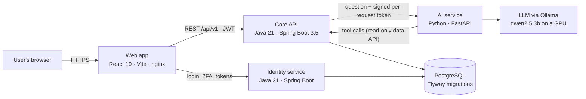

<h1 align="center">FinTwin AI</h1>

<p align="center">
  <b>An AI money copilot for young Indian earners.</b><br>
  Reads your bank and UPI statements, shows where every ₹ goes, and answers money questions from your own numbers.
</p>

<p align="center">
  <a href="https://fintwin-web.azurewebsites.net"><b>Live demo: one click, no sign-up</b></a>
  &nbsp;·&nbsp; Public beta &nbsp;·&nbsp; v0.1.0
</p>

<p align="center">
  
</p>

---

## The problem

Young earners in India have money spread across bank accounts, UPI apps, cards, loans and investments, with no single view of it. Statements are cryptic (`UPI/DR/PAYTM-XYZ` says nothing about groceries or rent). Budgeting apps depend on manual entry and get abandoned, and general chatbots can explain an SIP but don't know whether *you* can afford one this month.

## What FinTwin does

- **Data in, no typing.** Import bank statements as CSV, PDF or Excel, or forward bank alert emails (DKIM-verified). Bank linking through RBI's Account Aggregator framework is in testing.
- **Understood automatically.** Every transaction is categorized by rules, learned merchant rules and an LLM, and the categorizer learns from your corrections. Transfers between your own accounts are excluded, and recurring bills and unusual spending are flagged.
- **An AI copilot that uses your real numbers.** Ask a money question in plain English and the copilot looks up your actual income, spending and goals through tools before it answers. The maths is done in code, not by the model.
- **The full picture.** Dashboard, analytics, budgets, a financial health score, goal plans, net worth, investments, insurance and a cash-flow forecast.
- **Try it without an account.** A shared, read-only demo account behind "Try the demo".

<p align="center">
  
</p>

## Architecture



Four services, one rule: **Java owns the data, Python owns the thinking.** The AI service has no database access. When the model needs a user's transactions it calls the core API, which decides what that user may see.

| Service | Stack | Responsibility |
|---|---|---|
| `frontend/` | React 19, Vite 8, React Router 7 | The web app, landing page and demo |
| `backend/` | Java 21, Spring Boot 3.5, Spring Security, JPA, Flyway | Transactions, budgets, goals, net worth, imports, admin, the AI data API |
| `identity-service/` | Java 21, Spring Boot | Sign-up, login, JWT with rotating refresh tokens, TOTP 2FA, Google Sign-In, account lockout |
| `ai-service/` | Python, FastAPI, pandas, pdfplumber | Copilot tool loop, categorization, statement parsing, forecasting, anomaly detection, evals |

## Engineering highlights

**AI that can't be talked into leaking data**
- The model's tools have no user-ID parameter: it can say *what* it wants, never *whose*.
- Each question carries a short-lived token signed by the core API and bound to one user. The AI service can pass it on but cannot mint one.
- A shared grounding guard checks model-written text in the spending coach, goal plans and reports: every ₹ figure must be one the model was given, attached to the right thing.
- An eval suite of real questions over a fixture user, graded by code rather than another model, measures every prompt or model change.

**Security**
- AES-256-GCM field-level encryption with a random IV per value, plus an HMAC blind index so encrypted emails can still be looked up.
- Refresh-token rotation with reuse detection: a replayed token revokes the whole token family.
- TOTP 2FA with replay protection, account lockout, role-based access control with a custom permission evaluator, and an audit log.
- Rate limiting per IP and per user, and a daily AI token allowance per user.

**Reliability**
- Circuit breakers around the AI service. When the model is down, forecasts fall back to a statistical calculation and the app says plainly that AI is offline.
- Money is handled as `BigDecimal` and dates as `LocalDate`, with a documented monthly-units contract between the Java and Python services.

**Testing and delivery**
- **1,100+ automated tests**: 448 in the AI service (pytest), about 400 across the two Spring Boot services (including Testcontainers integration tests on real PostgreSQL), and 267 in the frontend (Vitest).
- GitHub Actions: a CI workflow per service, a security scan, and a CD workflow that builds and pushes container images.
- Runs today on Azure App Service (web, API, identity), with PostgreSQL on Supabase and the AI service on a GPU machine behind a tunnel. Every service is containerised.

## Repository layout

```
frontend/           React web app
backend/            Core API (Spring Boot)
identity-service/   Login and identity (Spring Boot)
ai-service/         AI copilot, categorization, forecasting (FastAPI)
docs/               Design notes, security reviews, deployment runbooks
ops/                Monitoring alert rules
scripts/            Deployment and local tooling
```

Good places to start reading: [`ARCHITECTURE.md`](ARCHITECTURE.md), [`docs/system-flow.md`](docs/system-flow.md), [`docs/identity-service-security-fixes.md`](docs/identity-service-security-fixes.md) and [`docs/backend-financial-logic-fixes.md`](docs/backend-financial-logic-fixes.md).

## Running locally

See [`docs/start-app.md`](docs/start-app.md) for the step-by-step guide (environment variables, database, Ollama, then each service), or run `./dev.sh` to start everything in one tmux session.

## Status

FinTwin is in **public beta** with early users. Next up: Account Aggregator linking out of testing, a mobile-friendly app, and a hosted model option chosen by the eval suite.

## Team

Built by **Syed Mohammad Saad** (Founder & CTO), with **Jawad Mohammed** (Co-founder, AI agents and go-to-market).

- LinkedIn: [linkedin.com/in/syedmdsaad](https://www.linkedin.com/in/syedmdsaad/)
- Portfolio: [syedmdsaad.github.io/Portfolio](https://syedmdsaad.github.io/Portfolio/)

## License

Copyright © 2026 Syed Mohammad Saad. All rights reserved. The code is public so it can be read; it is not licensed for reuse. See [`LICENSE`](LICENSE).
