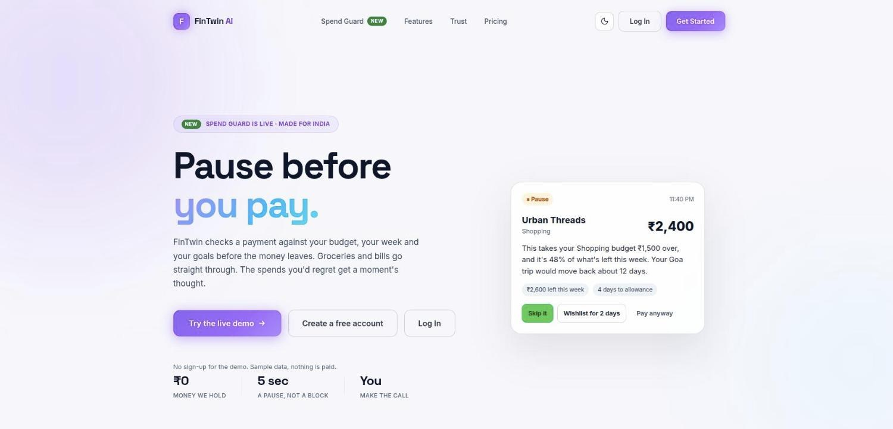
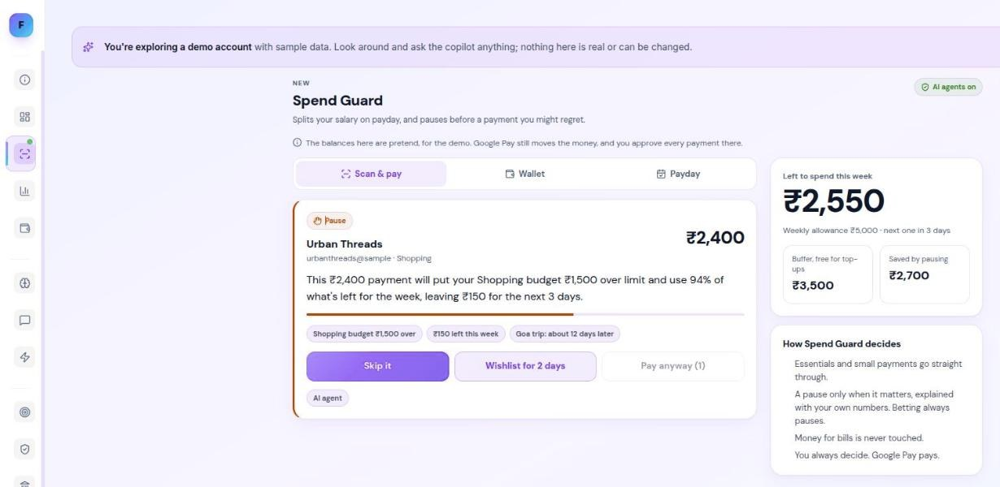
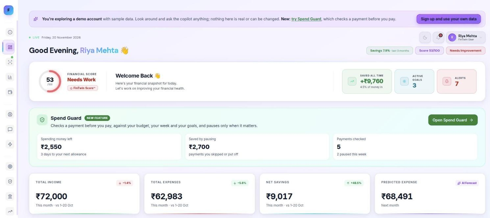
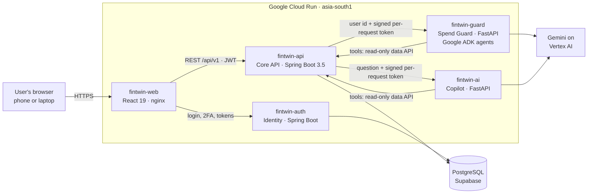

<h1 align="center">FinTwin AI</h1>

<p align="center">
  <b>Pause before you pay.</b><br>
  An AI money copilot for young Indian earners. Its new feature, <b>Spend Guard</b>, checks a UPI payment
  against your budget, your week and your goals before the money leaves.
</p>

<p align="center">
  <a href="https://fintwin-web-171222129367.asia-south1.run.app"><b>Live demo: one click, no sign-up</b></a>
  &nbsp;·&nbsp; Public beta &nbsp;·&nbsp; Runs on Google Cloud Run with Gemini on Vertex AI
</p>

<p align="center">
  
</p>

---

## The problem

UPI made paying instant: scan, PIN, done. That's great for paying and terrible for noticing. Young earners in
India see where their money went only at the end of the month, in a statement, when it's too late to change
anything. Budgeting apps report on spending after it happens. Nothing steps in at the one moment that matters:
just before you pay.

## Spend Guard (new)

Scan a shop's QR code (or type a UPI ID) in FinTwin before you pay. In a few seconds Spend Guard decides:

- **Essentials and small payments go straight through.** Groceries, bills, rent and small amounts never wait,
  and never reach the AI ("fast lane").
- **The rest gets a check by an AI agent** that reads your budgets, this week's spending money and your goals.
  When a payment matters, it **pauses** and says why, with your own numbers: *"This ₹2,400 takes your Shopping
  budget ₹1,500 over and pushes your Goa trip back about 12 days."*
- **A pause, never a block.** *Pay anyway* unlocks after five seconds; you can skip it or put it on a 48-hour
  wishlist. **Betting always pauses**, whatever the amount (a rule in code, not a line in a prompt).
- **Then Google Pay pays.** FinTwin never holds money. It opens Google Pay with the payee and amount filled in
  (PhonePe and Paytm as backups); on a computer it shows the payment as a QR code to scan with your phone.
- **It only counts once it's paid.** Tapping Pay leaves the payment waiting until you say "I paid" or the
  payment shows up in your transactions. When a bank statement comes in without it, Spend Guard asks whether you
  paid, so a payment that never happened can't quietly lower your savings.
- **Payee unknown?** Paying a person or an unrecognised UPI ID, it asks what the payment is for first.
- **Salary day.** The Payday Planner splits your salary into bills, goals, a buffer and four weekly allowances
  (or you set the split yourself; it's checked the same way). A top-up agent and a rebalance agent move money
  between weeks without ever touching bill money.

<p align="center">
  
</p>

## What else FinTwin does

- **Data in, no typing.** Import bank statements as CSV, PDF or Excel, or forward bank alert emails
  (DKIM-verified).
- **Understood automatically.** Every transaction is categorized by rules, learned merchant rules and an LLM,
  and the categorizer learns from your corrections.
- **An AI copilot that uses your real numbers.** Ask a money question in plain English; the copilot looks up
  your actual income, spending, goals and Spend Guard activity through tools, instead of guessing.
- **The full picture.** Dashboard, analytics, budgets, a financial health score, goal plans, net worth,
  investments, insurance and a cash-flow forecast.
- **Try it without an account.** A shared demo account behind "Try the live demo", with its own sandboxed
  Spend Guard for every visit.

<p align="center">
  
</p>

## Google AI in FinTwin

| What | How |
|---|---|
| **Spend Guard's agents** | Four [Google ADK](https://google.github.io/adk-docs/) `LlmAgent`s (payment check, top-up, payday planner, rebalance) on **Gemini (3.7 Flash) on Vertex AI**, run by ADK `Runner`s in `guard-service/agents/brain.py`. The payday planner reads the user's budgets and goals through **tools**; the other three get the facts already worked out in code. Every agent answers in a typed **output schema**. |
| **Code has the last word** | Every answer is checked in code before anyone sees it (`guard-service/rules.py`): the decision must fit the facts, every ₹ figure in the message must be one the agent was given, betting can't go through, a plan must add up to the salary. A rejected answer is retried (up to three attempts), then a fixed-rules fallback answers, and the app says so. |
| **Evals** | 23 scenario cases (`guard-service/evals/`) graded by code, run on Vertex AI across Gemini models to choose the model and to check every prompt change. |
| **Copilot and AI service** | The copilot's tool loop, categorizer, spending coach and reports run on Gemini on Vertex AI through `google-genai` (`ai-service/utils/gemini_client.py`). |
| **Governance** | Personal details are masked before anything reaches Gemini and in logs; payee names and the user's own words are passed as untrusted text; the copilot stays on money topics; every AI read of user data is audited ([`docs/ai-governance.md`](docs/ai-governance.md)). |
| **Agent Skill** | [`.agents/skills/spend-guard-guardrails`](.agents/skills/spend-guard-guardrails/SKILL.md): Spend Guard's payment-safety rules as an Agent Skill, with a rule-to-code-to-test map and a check script that coding agents (and people) run before any change. |

## Architecture



One rule: **Java owns the data, Python owns the thinking.** Neither Python service has database access. When
an agent needs a user's budgets or transactions it calls a tool, and the tool calls the core API's internal
data API with a short-lived token the API signed for that one user and request. The model never sees or
chooses a user id.

| Service | Stack | Responsibility |
|---|---|---|
| `frontend/` | React 19, Vite, React Router 7 | The web app, landing page and demo |
| `backend/` | Java 21, Spring Boot 3.5, Spring Security, JPA, Flyway | Transactions, budgets, goals, imports, Spend Guard's records and links, the AI data API |
| `identity-service/` | Java 21, Spring Boot | Sign-up, login, JWT with rotating refresh tokens, TOTP 2FA, Google Sign-In, account lockout |
| `guard-service/` | Python, FastAPI, Google ADK, google-genai | Spend Guard: the four agents, the rules that check them, the wallet, evals |
| `ai-service/` | Python, FastAPI, google-genai, pandas, pdfplumber | Copilot tool loop, categorization, statement parsing, forecasting, anomaly detection, evals |

Built and shipped with **Cloud Build** and **Artifact Registry**; each service is a container on **Cloud Run**.

## Engineering highlights

**AI that can't be talked into leaking data or making up numbers**
- The model's tools have no user-ID parameter: it can say *what* it wants, never *whose*.
- Each request carries a short-lived token signed by the core API and bound to one user. The Python services
  can pass it on but cannot mint one.
- A grounding guard checks model-written text: every ₹ figure must be one the model was given.
- Eval suites over fixture users, graded by code rather than another model, measure every prompt or model
  change.

**Security**
- AES-256-GCM field-level encryption with a random IV per value, plus an HMAC blind index so encrypted emails
  can still be looked up. Spend Guard's own records are stored encrypted.
- Refresh-token rotation with reuse detection: a replayed token revokes the whole token family.
- TOTP 2FA with replay protection, account lockout, role-based access control with a custom permission
  evaluator, and an audit log.
- Rate limiting per IP and per user, a daily AI allowance per user, and per-visit caps on the demo.

**Reliability**
- Circuit breakers around the AI service, and a fixed-rules fallback in Spend Guard. When a model is down,
  Spend Guard still answers and forecasts fall back to a statistical calculation, and the app says plainly that
  AI is offline.
- Money is handled as `BigDecimal` and dates as `LocalDate`, with a documented monthly-units contract between
  the Java and Python services.

**Testing and delivery**
- **1,400+ automated tests**: 508 in the AI service and 143 in Spend Guard (pytest), about 450 across the two
  Spring Boot services (including Testcontainers integration tests on real PostgreSQL), and 340 in the frontend
  (Vitest).
- GitHub Actions: a CI workflow per service and a security scan.

## Repository layout

```
frontend/           React web app
backend/            Core API (Spring Boot)
identity-service/   Login and identity (Spring Boot)
guard-service/      Spend Guard: ADK agents on Gemini, rules, evals (FastAPI)
ai-service/         AI copilot, categorization, forecasting (FastAPI)
.agents/skills/     Agent Skill with Spend Guard's guardrails
docs/               Design notes, security reviews, deployment runbooks
ops/                Monitoring alert rules
scripts/            Deployment and local tooling
```

Good places to start reading: [`ARCHITECTURE.md`](ARCHITECTURE.md), [`docs/system-flow.md`](docs/system-flow.md), [`docs/identity-service-security-fixes.md`](docs/identity-service-security-fixes.md) and [`docs/backend-financial-logic-fixes.md`](docs/backend-financial-logic-fixes.md).

## Running locally

See [`docs/start-app.md`](docs/start-app.md) for the step-by-step guide (environment variables, database, then each service), or run `./dev.sh` to start everything in one tmux session. The AI services use Gemini on Vertex AI by default (`gcloud auth application-default login`); a local model through Ollama is optional.

## Status

FinTwin is in **public beta** with early users. Spend Guard is new (November 2026). Next up: Account Aggregator linking out of testing, so payments are confirmed straight from the bank, and a mobile app with a one-tap scan.

## Team

Built by **Syed Mohammad Saad** (Founder & CTO), with **Jawad Mohammed** (Co-founder, AI agents and go-to-market).

- LinkedIn: [linkedin.com/in/syedmdsaad](https://www.linkedin.com/in/syedmdsaad/)
- Portfolio: [syedmdsaad.github.io/Portfolio](https://syedmdsaad.github.io/Portfolio/)

## License

Copyright © 2026 Syed Mohammad Saad. All rights reserved. The code is public so it can be read; it is not licensed for reuse. See [`LICENSE`](LICENSE).
